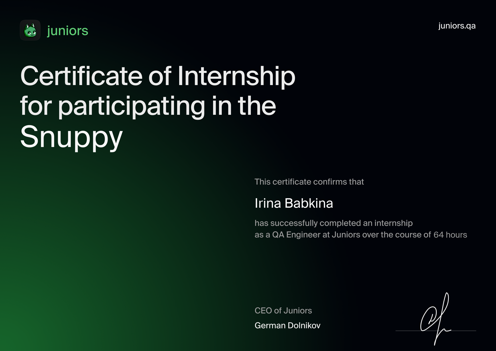
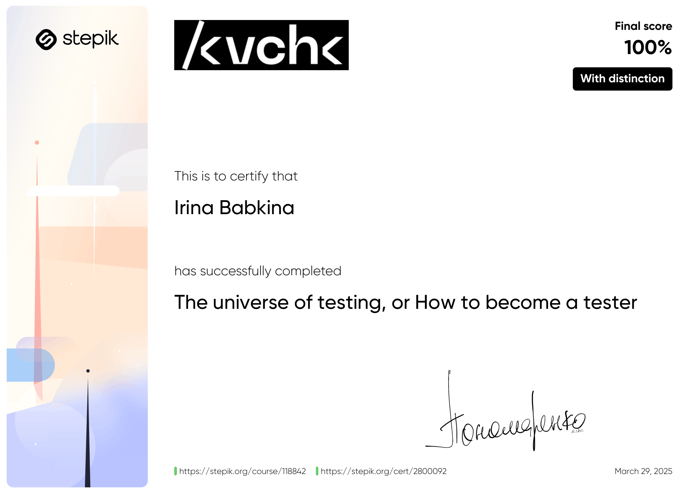

## Hello! 🧩 I'm Ira, a QA Engineer

Software Quality & Testing

   
   
   
   
   
   
   
   
   
   
   
   
   
   
   
   
  

---

GitHub Activity

Experience & Practice

&nbsp;&nbsp;

Education & Certifications

&nbsp;&nbsp;

