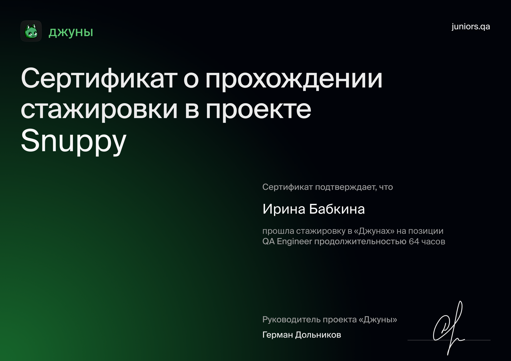
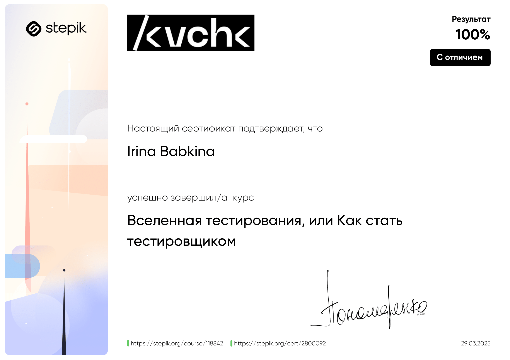
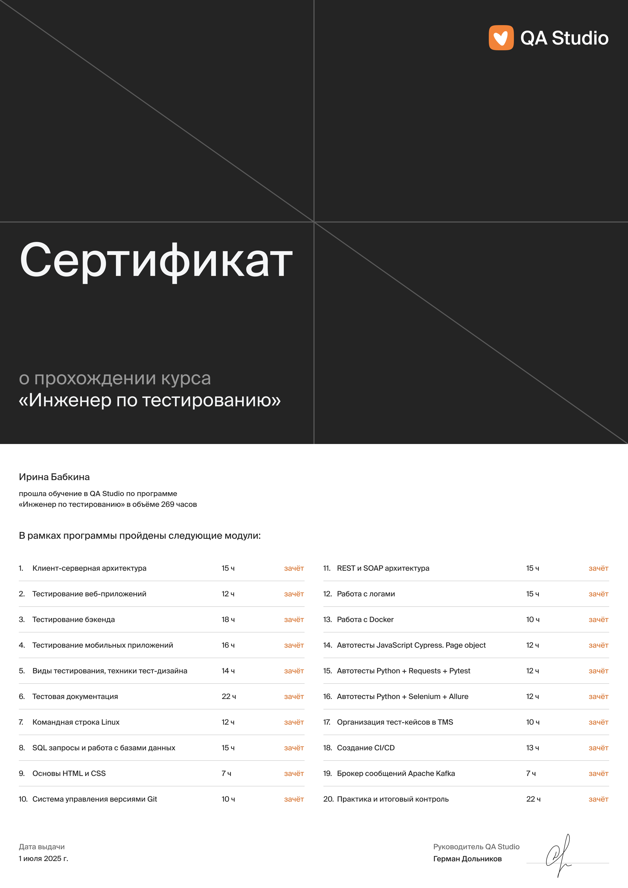
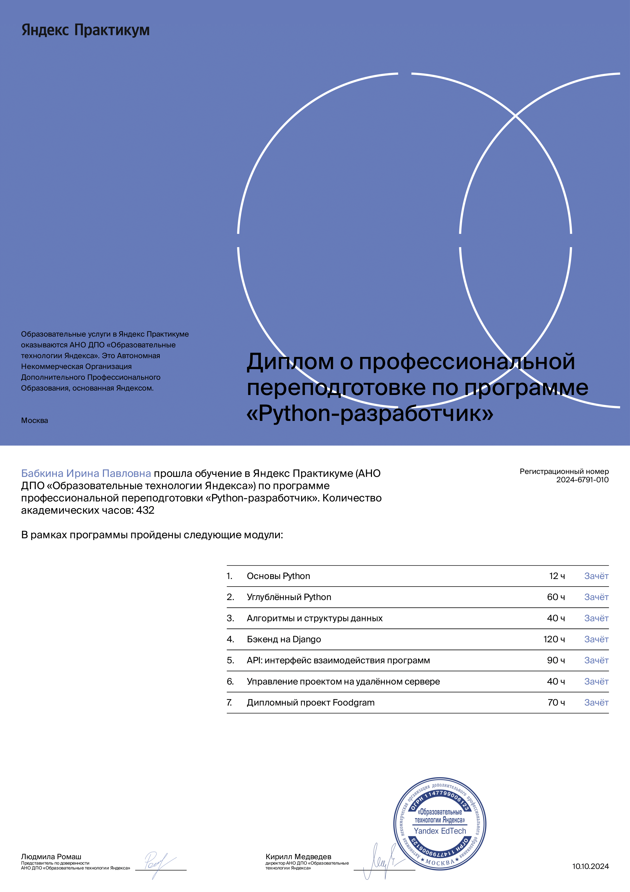

Привет ✨ я [Ира](https://irreny.github.io)  
======================

**Обо мне**

- 🔍 Искатель багов | Тестировщик 👨‍💻

- ❤️ Мне нравится разбираться в новых инструментах и участвовать в создании процессов и документации

- 💬 Написать можно в [Telegram](https://t.me/birreny) или на [почту](mailto:birreny@yandex.ru)

  
  
  
  
  
  
  
  
  
  
  
  
  
  
  
  
  

---
### :fire: Моя статистика

## 🌱 Практика и стажировка

## 🧙🏻‍♂️ Образование

